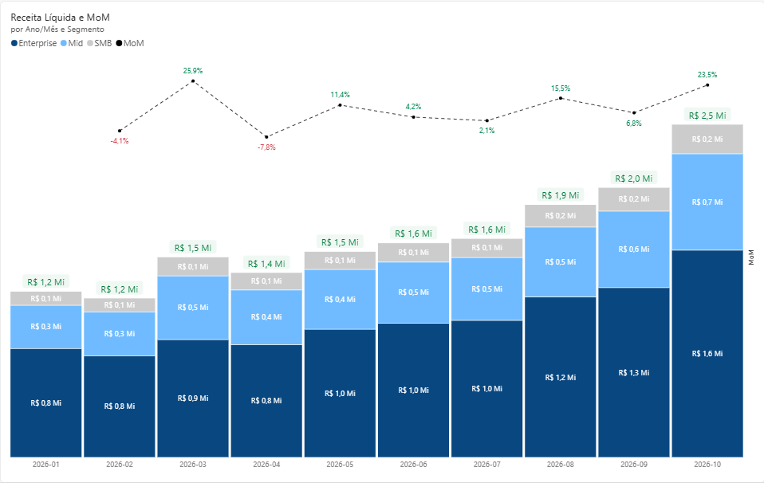

# Relatório executivo – Receita NuvemBR (jan–out/2026)

Para a diretoria · Base: faturas válidas, líquido = bruto − créditos, por competência · Painel: <code>6_Painel Executivo.pdf</code>

## Resposta
- **Crescimento saudável, mas concentrado:** a receita líquida dobrou (R$ 1,24 mi em jan → R$ 2,50 mi em out), puxada pelos clientes atuais (NRR de 124%). Não houve clientes novos em set e out, e 10 clientes somam 58% da receita.
- **Onde perdemos receita:** consumo não faturado (R$ 103 mil, problema ainda ativo), inadimplência (R$ 556 mil) e créditos SLA a verificar (R$ 36 mil).
- **Confiança nos números:** 9 inconsistências na origem explicavam a divergência entre áreas; todas foram tratadas ou reportadas numa base única e testada.

## Achados
| # | Achado | Valor |
|---|---|---|
| 1 | Crescimento veio da base atual; nenhum cliente novo em set e out | NRR 124% · 81 ativos |
| 2 | Receita concentrada nos 10 maiores clientes | 58% (maior cliente: 12%) |
| 3 | Kubernetes de 4 contas consumido e não faturado desde jun | R$ 102,8 mil (~R$ 28 mil/mês) |
| 4 | Faturas vencidas das competências de jul a set | R$ 555,9 mil |
| 5 | Ago/26: crédito promocional somado em vez de subtraído; 9 clientes pagaram a mais | R$ 13,3 mil |
| 6 | Dados de origem: dia de consumo duplicado, TB no lugar de GB, 6 contas sem cliente | 12% da receita estava sem segmento |

## Recomendações
| Ação | Dono | Impacto |
|---|---|---|
| Corrigir a cobrança do Kubernetes e avaliar a cobrança retroativa | Billing | R$ 103 mil + ~R$ 28 mil/mês |
| Reembolsar ou compensar os 9 clientes cobrados a mais em ago/26 | Billing + Financeiro | R$ 13,3 mil |
| Cobrar as faturas vencidas | Financeiro | R$ 556 mil |
| Retomar a aquisição de clientes novos | Comercial / Marketing | Crescer sem depender só da base |
| Plano de retenção para os 10 maiores clientes | Comercial / CS | 58% da receita |
| Documentar a regra do crédito SLA | Suporte + Billing | R$ 36 mil |
| Corrigir na origem: recarga de consumo, unidade TB/GB, vínculos conta × cliente e ticket × conta | Dados, Medição, CRM, Suporte | Fim da divergência entre áreas |

## Clientes cobrados a mais (ago/26, faturas pagas)
| Cliente | Fatura | Pago a mais |
|---|---|---|
| C0070 Jade Saúde · C0074 Norte Varejo · C0082 Boreal Saúde | NF-000590 · 000595 · 000603 | R$ 3.000,00 cada |
| C0063 Cedro Educação (devia pagar R$ 0) | NF-000583 | R$ 1.473,68 |
| C0084 Delta Seguros (devia pagar R$ 0) | NF-000605 | R$ 790,82 |
| C0089 Ipê Educação · C0067 Gama Logística · C0073 Maré Educação | NF-000610 · 000587 · 000785 | R$ 600,00 cada |
| C0069 Ipê Agro (devia pagar R$ 0) | NF-000589 | R$ 270,08 |
| **Total** | | **R$ 13.334,58** |

## Outros pontos de atenção
Encontrados na base, fora do foco deste trabalho:

- **Maior churn do período:** C0062 Boreal Mídia (Enterprise) parou de consumir em mar/26; faturava ~R$ 120 mil/mês. No total, 9 clientes saíram.
- **Razão social não identifica o cliente:** 80 dos 90 clientes dividem o nome com outros (CNPJs diferentes). Relatórios por nome somam clientes distintos.
- **Inadimplência concentrada:** 45% do valor vencido é da competência de set/26 (R$ 250 mil).
- **Créditos SLA em alta:** out/26 teve R$ 21 mil, o maior mês, em apenas 2 créditos. E os 57 chamados de indisponibilidade não geraram nenhum crédito SLA.
- **Crédito excedente se perde:** quando o crédito passa do valor da fatura, a sobra não vai para o mês seguinte (regra não documentada).
- **Tempo de atendimento maior do que parecia:** 20,6 h em média, e não 17,6 h; 13% dos chamados provavelmente estão ligados à conta errada.
- **Dependência regional:** o Sudeste concentra 65% do consumo.

## Premissas
- Receita = líquido faturado das faturas válidas; canceladas não entram.
- Segmento = o do cliente em cada mês (8 clientes mudaram, todos para cima).
- NRR mensal sobre a receita bruta, por cliente; churn = ativo no mês anterior e sem receita no mês.
- Promocional no 2º mês tratado como regra da campanha (a confirmar com Marketing).

## Fora do escopo
Foco nas inconsistências de valor. Ficaram como próximos passos: automação com dbt/Airflow (hoje: script e testes SQL), indicadores de suporte no painel, detalhamento por conta, cohort e NRR anual, e validação das premissas com as áreas.
